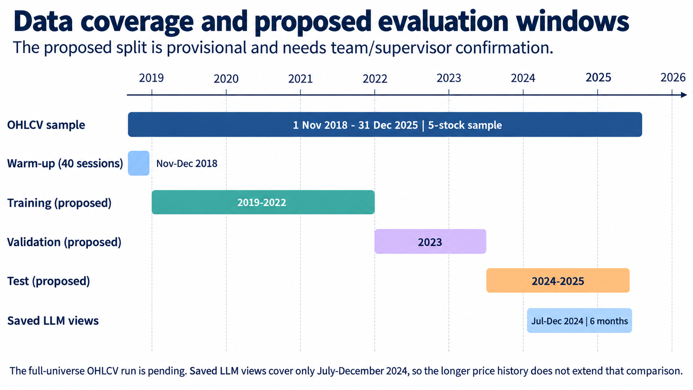

# Agentic AI for Financial Portfolio Balancing

This is a student research project built on the LLM-BLM repository. It preserves the original saved LLM-BLM responses and baseline code, and adds a Semester V data pipeline, technical indicators, a portfolio-state interface, and baseline evaluation audits.

## Current Status

| Area | Status |
|---|---|
| OHLCV data pipeline | Implemented and checked on a five-stock sample |
| Technical indicators and risk features | Implemented and checked on the five-stock sample |
| Portfolio state interface | Specified; not connected to a trained agent |
| Saved LLM-BLM comparison | Existing six-month results; preliminary and under audit |
| Full-universe data run | Not completed; the final asset list is not selected |
| PPO/SAC agent and integrated XAI | Future work; not implemented |


## Project Structure

```
.
├── src/                 # Data, features, and evaluation code
├── data/                # OHLCV samples and feature outputs
├── responses/           # Saved LLM responses
├── responses_portfolios/
├── results/
├── yfinance/            # Original market data
├── figure/              # Project plots
└── docs/                # Reports and project documentation
```

## Workflow Description

1. **Prepare market data:** The OHLCV pipeline downloads and checks daily price and volume data. It has been validated on a five-stock sample; the final full universe is not yet selected.
2. **Build features and state:** The feature code calculates technical indicators and risk estimates. The state interface organizes these values for a future portfolio agent; it is not yet connected to a trained agent.
3. **Compare existing strategies:** The repository contains Equal Weight, MVO, and LLM-BLM baselines using saved LLM responses. The current comparison covers six months in 2024; its results are preliminary and the turnover/cost evaluation needs correction.
4. **Future work:** Train a PPO or SAC portfolio agent and add XAI explanations. These components are not implemented yet.



No new LLM responses are required for the existing saved-response comparison.

## File Descriptions

### Main Files
- `run.py`: Generates LLM views for stock returns. New views require a configured LLM endpoint.
- `baselines.py`: Builds equal-weight and mean-variance portfolio baselines.
- `evaluate_multiple.py`: Applies Black–Litterman using saved LLM views and compares portfolios.
- `calculate_llm_returns.py`: Calculates returns for LLM-based portfolios.
- `src/data/ohlcv_pipeline.py`: Downloads and prepares OHLCV market data.
- `generate_features.py`: Calculates technical indicators and risk features.
- `validate_features.py`: Validates the generated features.

### Directories
- `responses/`: Saved LLM views from the existing July–December 2024 experiment.
- `responses_portfolios/`: Portfolio weights and returns.
- `results/`: Evaluation outputs and performance metrics.
- `yfinance/`: Legacy price and return data used by the original workflow.
- `docs/figures/`: Project diagrams and evaluation visuals.

## Usage


```bash
python -m venv .venv
.\.venv\Scripts\Activate.ps1
python -m pip install -r requirements.txt
python src/data/ohlcv_pipeline.py --universe sample
python generate_features.py
python validate_features.py
```
The existing LLM-BLM evaluation uses saved views in responses/. Generating new LLM views with run.py requires a configured model endpoint and credentials.
