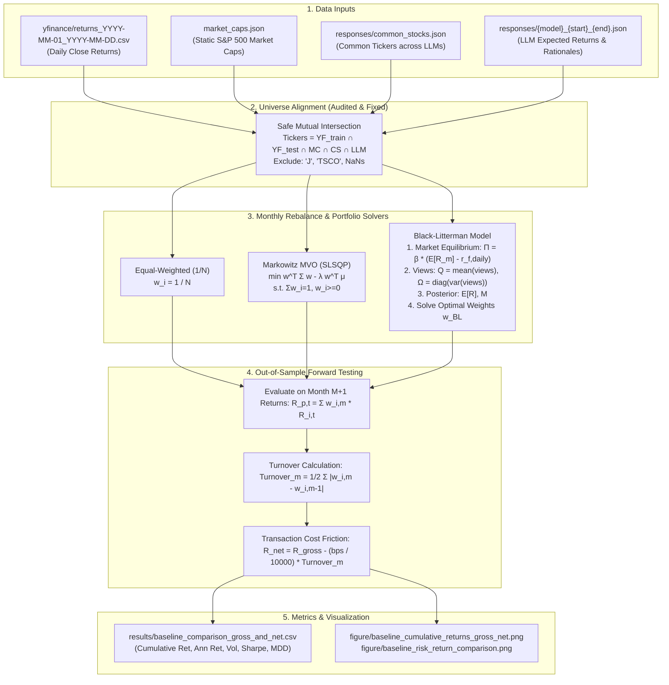

# Baseline Audit and Evaluation Protocol

**Role Owner:** Person 3 (Baselines and Evaluation Owner)  
**Project:** Agentic AI for Financial Portfolio Balancing  
**Revision Date:** October 2026  
**Scope Boundary:** Semester V (FR-09 Backtesting, FR-10 Baseline Evaluation)

---

## 1. Executive Summary

This document establishes the verified workflow map, mathematical specifications, code audit findings, and standardized evaluation protocol for all portfolio baselines in the project.

In accordance with [`SEMESTER_V_WORK_PLAN.md`](../SEMESTER_V_WORK_PLAN.md), the baseline package evaluates three distinct investment paradigms over the 6-month out-of-sample window (**July 1, 2024 – December 31, 2024**) with monthly rebalancing:
1. **Heuristic Benchmark:** Equal-Weighted Portfolio ($1/N$).
2. **Classical Quantitative Baseline:** Markowitz Mean-Variance Optimization (MVO).
3. **LLM-Enhanced Quantitative Baseline:** Black-Litterman Model (BLM) informed by sentiment/expected return views from three Large Language Models:
   - **Gemma-7B**
   - **LLaMA-3.1-8B**
   - **Qwen2-7B**

---

## 2. End-to-End Workflow Map

The following lineage diagram details how raw data flows through optimization routines to produce forward returns and risk-adjusted metrics:

---

## 3. Mathematical Formulations

### 3.1. Equal-Weighted Benchmark ($1/N$)
For an aligned universe of $N$ assets:
$$w_i = \frac{1}{N}, \quad \forall i \in \{1, \dots, N\}$$
The forward portfolio return at time $t$ is:
$$R_{p, t}^{EW} = \sum_{i=1}^N \frac{1}{N} R_{i, t}$$

---

### 3.2. Classical Markowitz Mean-Variance Optimization (MVO)
Given historical daily returns over training month $M$ (length $T$), let:
- $\mu = \frac{1}{T} \sum_{t=1}^T R_t \in \mathbb{R}^N$ denote the sample mean return vector.
- $\Sigma = \frac{1}{T-1} \sum_{t=1}^T (R_t - \mu)(R_t - \mu)^T \in \mathbb{R}^{N \times N}$ denote the sample covariance matrix.

The optimization problem solved via Sequential Least Squares Programming (SLSQP) is:
$$\min_{w} \quad w^T \Sigma w - \lambda w^T \mu$$
$$\text{subject to} \quad \sum_{i=1}^N w_i = 1, \quad w_i \ge 0 \quad \forall i$$
where $\lambda = 0.1$ is the investor risk aversion parameter.

---

### 3.3. LLM-Enhanced Black-Litterman Model (BLM)
The Black-Litterman model blends the market equilibrium prior with subjective views generated by Large Language Models.

#### A. Market Equilibrium Prior ($\Pi$)
Let $w_{mkt} \in \mathbb{R}^N$ be the market-cap weights normalized from `market_caps.json`:
$$w_{mkt, i} = \frac{MC_i}{\sum_{j=1}^N MC_j}$$
The market index return series is $R_{m, t} = \sum_{i=1}^N w_{mkt, i} R_{i, t}$.  
Each asset's beta relative to the market proxy is:
$$\beta_i = \frac{\text{Cov}(R_i, R_m)}{\text{Var}(R_m)}$$
The **corrected daily risk-free rate** $r_{f, daily}$ is derived from the annual rate $r_{f, annual} = 0.02$:
$$r_{f, daily} = (1 + r_{f, annual})^{1/252} - 1 \approx 0.00007907$$
The market risk premium is:
$$\text{MRP}_{daily} = \mathbb{E}[R_m] - r_{f, daily}$$
The equilibrium prior return vector $\Pi \in \mathbb{R}^N$ is:
$$\Pi = \beta \cdot \text{MRP}_{daily}$$

#### B. LLM Views Extraction ($P, Q, \Omega$)
For each asset $i$, the LLM provides repeated predictions of expected return $\{r_{i}^{(1)}, \dots, r_{i}^{(K)}\}$ in the response JSON:
- **View Vector $Q \in \mathbb{R}^N$:**
  $$Q_i = \frac{1}{K} \sum_{k=1}^K r_{i}^{(k)}$$
- **Pick Matrix $P \in \mathbb{R}^{N \times N}$:**
  $$P = I_N \quad (\text{absolute views on all assets})$$
- **View Uncertainty Covariance $\Omega \in \mathbb{R}^{N \times N}$:**
  $$\Omega_{ii} = \max\left(\frac{1}{K-1} \sum_{k=1}^K (r_i^{(k)} - Q_i)^2, \; \epsilon\right), \quad \Omega_{ij} = 0 \; (i \ne j)$$
  where $\epsilon = 10^{-6}$ provides numerical regularization against singular view variance.

#### C. Posterior Distribution
With scaling hyperparameter $\tau = 0.025$:
$$M = \left[ (\tau \Sigma)^{-1} + P^T \Omega^{-1} P \right]^{-1}$$
$$E[R]_{BL} = M \left[ (\tau \Sigma)^{-1} \Pi + P^T \Omega^{-1} Q \right]$$
The final portfolio weights are obtained by solving the quadratic optimization with $E[R]_{BL}$ in place of $\mu$.

---

## 4. Code & Workflow Discrepancy Audit

During the audit of the legacy clone repository, Person 3 identified five critical discrepancies between the conceptual documentation and the scripts:

| # | Discrepancy Found in Legacy Code | Affected File | Impact | Resolution in `src/evaluation/` |
|---|---|---|---|---|
| **1** | **Annual vs Daily Risk-Free Rate Mismatch** | [`evaluate_multiple.py:67-71`](file:///c:/college_project/Agentic-Portfolio-Balancing/evaluate_multiple.py#L67-L71) | Line 67 subtracted annual `0.02` from daily returns (~0.05%), resulting in an absurdly negative daily risk premium of ~-1.95% (-490% annualized) and distorting $\Pi$. | Corrected to daily compound rate: $r_{f, daily} = (1 + 0.02)^{1/252} - 1$. |
| **2** | **Asymmetric Ticker Drop / Dimension Misalignment** | [`baselines.py:62-68`](file:///c:/college_project/Agentic-Portfolio-Balancing/baselines.py#L62-L68) | `data` and `future_data` were filtered independently by `.dropna(axis=1)`. If an asset was missing in forward returns, matrix multiplication threw dimension errors. | Implemented `get_aligned_universe()` taking mutual intersection across all inputs. |
| **3** | **Look-Ahead / Survivorship Bias in Market Caps** | [`market_caps.json`](file:///c:/college_project/Agentic-Portfolio-Balancing/market_caps.json) | A static snapshot of 2024 market caps was applied retrospectively to all rebalance months. | Documented as an explicit Semester V data limitation; point-in-time caps planned for Semester VI. |
| **4** | **Absence of Turnover & Transaction Cost Friction** | [`visualize_results.py`](file:///c:/college_project/Agentic-Portfolio-Balancing/visualize_results.py) | Performance was reported purely gross of transaction costs, artificially inflating active baseline Sharpe ratios. | Built turnover computation and transaction cost deduction engine ($0, 5, 10$ bps). |
| **5** | **Horizon Truncation (6 Months vs SRS 1–2 Years)** | [`calculate_llm_returns.py`](file:///c:/college_project/Agentic-Portfolio-Balancing/calculate_llm_returns.py) | Model response files cover only June–December 2024 (evaluating July–Dec 2024). January 2025 cannot be evaluated without forward price data. | Confirmed 6-month legacy out-of-sample window as the official Semester V benchmark. |

---

## 5. Standardized Evaluation Protocol

To ensure fair comparison when Deep Reinforcement Learning (PPO / SAC) models are integrated in Semester VI, all future models must strictly adhere to the following protocol:

1. **Out-of-Sample Window:** `2024-07-01` to `2024-12-31` (127 trading days).
2. **Rebalancing Frequency:** Monthly (first trading day of each month).
3. **Asset Universe:** Standardized common intersection of surviving S&P 500 stocks (440+ assets).
4. **Friction Schedule:**
   - **Gross Return:** $0$ bps.
   - **Baseline Institutional Friction:** $5$ bps ($0.05\%$) per unit of portfolio turnover.
   - **Stressed Friction:** $10$ bps ($0.10\%$) per unit of portfolio turnover.
5. **Standard Annualization Constants:**
   - Days per year: $252$.
   - Annual risk-free rate: $2.0\%$ ($R_f = 0.02$).
   - Sharpe Ratio formula: $\text{Sharpe} = \frac{R_{ann} - R_f}{\sigma_{ann}}$.
